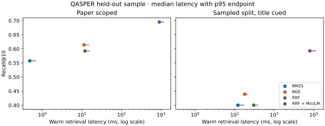

# Evidence Retrieval and Evaluation on QASPER

This project implements and evaluates four evidence retrieval methods for technical papers on a laptop CPU. It combines a reproducible held-out QASPER evaluation with a local Streamlit app for searching development papers, inspecting source passages, and comparing measured retrieval quality and latency.

## Held-out results

The experiment used a deterministic **40-paper QASPER v0.3 test sample** with **156 questions**. Of those, **126** qualified for evidence-ranking metrics. The primary setting searches the supplied target paper. The secondary setting searches the same 40-paper candidate pool and includes the target title in the query.

| Method | Paper Recall@10 | Paper MRR@20 | Paper nDCG@5 | Paper p50 / p95 latency | Title-cued pool Recall@10 |
| --- | ---: | ---: | ---: | ---: | ---: |
| BM25 | .557 | .388 | .317 | 0.48 / 0.69 ms | .400 |
| BGE-small | .614 | .511 | .442 | 11.25 / 15.13 ms | .439 |
| Reciprocal rank fusion | .593 | .467 | .401 | 11.87 / 15.87 ms | .400 |
| RRF + MiniLM | .695 | .543 | .470 | 900.81 / 1,190.27 ms | .593 |

MiniLM improved paper-scoped Recall@10 over RRF by **.103** (paired 95% interval **[.052, .155]**) at a substantial latency cost. BGE is the interactive default. The paper-scoped RRF-versus-BGE difference was **−.022 [−.063, .022]**. See the [technical report](docs/technical-report.md) and [frozen protocol and full results](docs/phase5.md) for denominators and all contrasts.



## How it works

1. Parse the official archive and retain paper, section, paragraph and character-offset provenance.
2. Chunk within paragraphs and search with BM25 or BGE-small exact cosine similarity. Fuse both top-50 rankings with reciprocal rank fusion, or rerank the fused top 20 with MiniLM.
3. Map evidence to paragraphs and unique section headings. Score completed annotated paragraphs on a shared eligible population. Estimate paired uncertainty by resampling papers.
4. Show live search over **20 prepared development papers**. The separate dashboard reads validated, recorded held-out results and never runs evaluation from the interface.

## Run locally on Windows

Python 3.12 is the verified clean-install environment. An internet connection is needed initially for Python packages and the official assets. The prepared app then runs locally on the CPU.

When cloning on Windows, use `git clone --config core.autocrlf=false https://github.com/zidaneb29/rag-rigorous-evaluation.git` to preserve the exact bytes of the hash-checked files. Run the following commands from the repository root.

```powershell
py -3.12 -m venv .venv
$appPython = '.\.venv\Scripts\python.exe'
& $appPython -m pip install -r requirements-ui.txt
& $appPython -m streamlit run streamlit_app.py
```

Open [localhost:8501](http://127.0.0.1:8501) and select **Evaluation dashboard** to view the bundled, text-free result snapshot. To enable live search on a fresh checkout, download the pinned [QASPER and BGE assets](docs/phase2.md#reproduce-the-pilot) and [MiniLM assets](docs/phase3.md#reproduction), then run the preparation command once:

```powershell
$env:OPENBLAS_NUM_THREADS = '2'
$env:TOKENIZERS_PARALLELISM = 'false'
& $appPython -m rag_eval --output artifacts/pilot-cold
& $appPython -m unittest discover -s tests -v
```

Use the [local app guide](docs/phase6.md) to reuse an existing index or prepare one under new paths. The dashboard works with the bundled snapshot while the explorer assets are being prepared.

## Reproduce the evaluation

Follow the [Phase 3 reproduction steps](docs/phase3.md#reproduction), then the [Phase 5 run and replay steps](docs/phase5.md#reproduction). The protocol pins the archive and model revisions, sampling rule, eligibility, rankings, and bootstrap seed. Checkpoints support resume without recomputing completed queries. Install `requirements-figures.txt` to render the SVGs from a saved report. A fresh run can vary in latency by hardware, software versions and system load.

| Location | Contents |
| --- | --- |
| `rag_eval/` | Corpus ingestion, indexing, ranking, scoring, experiment CLI and UI adapter |
| `configs/` | Versioned retrieval and application settings |
| `streamlit_app.py` | Development-paper explorer and read-only dashboard |
| `results/` | Compact dashboard snapshot from the verified run |
| `docs/` | [Technical report](docs/technical-report.md), [app guide](docs/phase6.md), [attribution](docs/third-party-notices.md) and phase records |
| `tests/` | Unit and Streamlit integration tests |

## Limits and future work

Results apply to the sampled test population and specified scopes. QASPER annotations can omit useful evidence, and complete annotated-set coverage measures a benchmark proxy. A paper title is an explicit cue in the secondary setting. CPU timing comes from one laptop. The [1.5B](docs/phase4.md), [prompt recovery](docs/phase4b.md), and [7B](docs/phase4c.md) feasibility checks are preserved as engineering findings. Full generation evaluation remains postponed.

## License

The project's original code and documentation are available under the [MIT License](LICENSE). See [third-party notices](docs/third-party-notices.md) for the terms and attribution of QASPER, models, papers, and dependencies.
