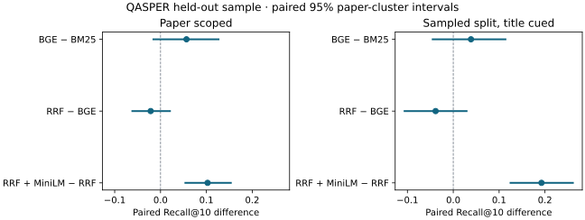

# Technical report · QASPER evidence retrieval

## Objective and setup

Measure whether dense retrieval, fusion or reranking improves the placement of annotated evidence for technical questions and quantify the CPU cost. The frozen evaluation sampled 40 papers from the QASPER v0.3 test split, retaining all 156 questions. Of those, 126 were eligible for evidence ranking. Twelve lacked a complete mapped text set, nine had tied answerability labels, and nine were majority-unanswerable. All 156 contributed to latency. The development explorer indexes a separate 20-paper sample.

The primary condition searches the supplied target paper with question text alone. The secondary condition searches the sampled 40-paper pool with the target title prepended. Both use the same paragraph-bounded, 256-token chunks and 32-token overlap for long paragraphs. Methods are BM25Okapi, normalized BGE-small cosine search, equal-weight RRF of the top 50 per base method with constant 60, and MiniLM reranking of the top 20 fused candidates.

## Metrics and uncertainty

An eligible question has a majority answerable label and at least one completely mapped text evidence set. Exact unique heading labels map to all indexed paragraphs in their section. A paragraph is found only when the retrieved chunk spans cover it in full. Recall@k divides completed annotated paragraphs by the annotated union. MRR@20 uses reciprocal rank of the first completed paragraph, with zero for a miss. nDCG@5 discounts first paragraph completions by chunk rank against an ideal order.

Paired differences use 2,000 paper-cluster percentile bootstrap draws, seed 42. Every sampled paper contributes all its paired eligible questions. Estimates are question-weighted within each draw. Intervals are descriptive and unadjusted for the comparison set.

## Held-out findings

| Method | Paper Recall@10 | Paper MRR@20 | Paper nDCG@5 | Title-cued pool Recall@10 |
| --- | ---: | ---: | ---: | ---: |
| BM25 | .557 | .388 | .317 | .400 |
| BGE-small | .614 | .511 | .442 | .439 |
| RRF | .593 | .467 | .401 | .400 |
| RRF + MiniLM | .695 | .543 | .470 | .593 |

Paper-scoped BGE improved nDCG@5 over BM25 by .125 [+.072, +.178]. Its Recall@10 difference was .057 [−.017, +.128]. RRF did not show a clear improvement over BGE on paper-scoped Recall@10 (−.022 [−.063, +.022]). MiniLM improved Recall@10 over RRF in paper scope by .103 [+.052, +.155] and in the title-cued pool by .192 [+.123, +.263]. [Full comparisons](phase5.md#held-out-results)

## Efficiency and failures

Warm paper-scoped p50/p95 latency was 0.48/0.69 ms for BM25, 11.25/15.13 ms for BGE, 11.87/15.87 ms for RRF and 900.81/1,190.27 ms for reranking. Timings exclude model load and indexing. BGE timing includes query encoding, and the two composite configurations sum their sequential component times. The 1,925-chunk run took 7.44 minutes across measured stages, peaked at 412.3 MiB process working set, and stored 2.96 MB of vector shards and checksums.

In the paper-scoped sample, RRF beat both base methods on Recall@10 for three questions and fell below the better baseline for 36. MiniLM raised nDCG@5 on 50 questions and lowered it on 22. A sampled regression moved an annotated paragraph from rank 1 to rank 3. Non-text evidence and incomplete labels reduce the scope of the quality estimates. A high annotated-set score does not establish factual sufficiency.

## Conclusion and limits

BGE is the responsive local default. MiniLM is an explicit option when the additional annotated evidence coverage is worth the delay. The sampled pool, title cue, partial evidence labels, conservative section mapping, single laptop, and unadjusted intervals limit generalization. The [generator feasibility reports](phase4.md) are separate engineering findings. The study establishes retrieval outcomes and leaves full answer-generation evaluation incomplete.
